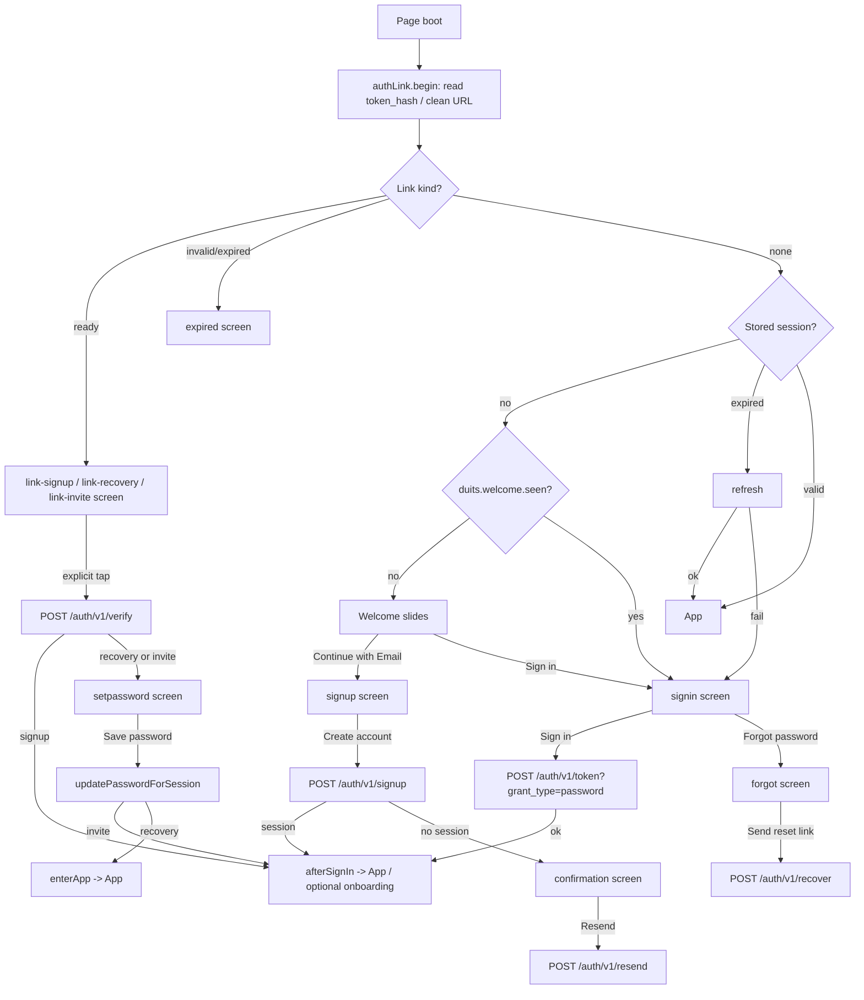

# Phase 6B-1A — Authentication UI Audit & Redesign Plan

- **Status:** Plan only. No implementation in this phase.
- **Branch:** `feature/public-onboarding`
- **Scope:** Browser authentication UI in `app/static/index.html`.
- **Out of scope:** Backend, API, database, RLS, Supabase settings, Google provider configuration, deployment.
- **Design context:** Phase 6A established the four-step welcome/onboarding experience. The Login and Sign Up screens still use the older, single-card auth UI and do not yet share that visual language.

> This document is a plan. It does not change application code, authentication behaviour, Supabase configuration or production settings.
>
> **Update (Phase 6B-3A):** the client-side Google OAuth PKCE flow is now implemented behind
> `GOOGLE_OAUTH_CONFIGURED = false`; the provider remains disabled and real Google E2E is still blocked.
> See `docs/decisions/ADR-001-authentication-link-and-oauth-architecture.md` §11.3. The rest of this
> document records the earlier plan.

---

## 1. Existing authentication UI audit

### 1.1 Where the auth UI lives

All authentication UI is in `app/static/index.html`:

| Area | Current location | Notes |
|---|---|---|
| Auth gate markup | `index.html:2391–2411` | One `#authScreen` gate with one `#authCard` |
| Auth CSS | `index.html:1391–1451` | `.auth`, `.auth-card`, `.auth-logo`, `.auth-title`, `.auth-note`, fields, submit, ghost links, foot |
| View renderer | `index.html:3293–3346` | `setAuthView(view, note)` |
| Show / hide gate | `index.html:3348–3364` | `showAuth`, `hideAuth` |
| Auth error mapping | `index.html:3196–3204` | `authError` |
| Submit / signup / recovery / set-password | `index.html:3900–4020` | `submitAuth` |
| Resend confirmation | `index.html:3886–3898` | `resendSignup` |
| Link verification | `index.html:3733–3783` | `verifyPendingLink` |
| Back from link views | `index.html:3785–3800` | `backFromAuth` |
| Sign out | `index.html:4022–4040` | `signOut` |
| Post-auth entry | `index.html:3676–3694` | `afterSignIn`, `enterApp` |
| Auth link core | `index.html:3386–3620` | DOM-free; extracted by `tests/js/auth_link_test.mjs` |
| Auth guard | `index.html:3574–3581` | Invalidates late responses after a view change |
| Verified session retention | `index.html:3284–3285`, `3764–3767`, `3963–3970` | `pendingAuthLinkType`, `pendingAuthSession` |
| Keyboard helpers | `index.html:4046–4074` | `AUTH_FIELDS`, `authFormHasFocus`, `revealAuthField`, `resetAuthScroll` |
| Auth event wiring | `index.html:6815–6845` | Button clicks, field focus/blur/keydown, visualViewport resize |
| Phase 6A welcome auth step | `index.html:2352–2370` | Google, Email, Sign in entry points |

### 1.2 Current auth views

`setAuthView` is the single renderer for every auth state. It is not a router; it toggles the same elements.

| View | Title | Fields visible | Primary action | Secondary actions | How it is reached |
|---|---|---|---|---|---|
| `signin` | Sign in | Email, password | Sign in | Forgot password, Create account | Welcome → Sign in, sign-out, expired session |
| `signup` | Create your account | Email, password, confirm | Create account | Back to sign in | Welcome → Continue with Email, Sign in → Create account |
| `forgot` | Reset password | Email | Send reset link | Back to sign in | Sign in → Forgot password |
| `confirmation` | Check your email | Email (disabled) | none | Resend confirmation, Back to sign in | Signup without an immediate session |
| `setpassword` | Set a new password | Email (disabled), password, confirm | Save password | Back | Recovery/invite link verified |
| `link-signup` | Confirm your email | none | Confirm email | Back | `?token_hash=…&type=signup` |
| `link-recovery` | Reset your password | none | Continue | Back | `?token_hash=…&type=recovery` |
| `link-invite` | Accept your invitation | none | Accept invitation | Back | `?token_hash=…&type=invite` |
| `expired` | This link can't be used | Email | none | Send reset link, Send new confirmation email, Back | Invalid/expired/legacy link, expired verified session |

### 1.3 Shared vs independent

**Shared across all views**

- The fixed `#authScreen` gate, the single `#authCard` column, logo, title, note and foot.
- `.field`, `.form-label`, `.btn-primary`, `.btn-ghost` styling.
- `setAuthView` visibility and copy logic.
- `authGuard` epoch checks and `pendingAuthSession` retention.
- Supabase REST helpers: `authRequest`, `authHeaders`, `authBase`.
- Session helpers: `readSession`, `writeSession`, `refreshSession`, `sessionExpired`.
- Post-auth entry: `afterSignIn`, `enterApp`, optional onboarding, What's New.
- Keyboard helpers and the 16px input floor.
- Error mapping and no-account-enumeration copy.

**Independent per view**

- Title and note copy.
- Which of the three fields are visible/disabled.
- Primary button label and visibility.
- Which secondary links are visible.
- Sign-up foot copy.
- Link-type branches and set-password handling.
- Google is currently **not** present on `#authScreen`; it exists only on welcome step 3.

### 1.4 Current visual system

Current auth CSS (`index.html:1391–1451`) is intentionally minimal:

- `#authScreen` is `position: fixed; inset: 0; z-index: 40`, `min-height: 100dvh`, `justify-content: safe center`, `overflow-y: auto`, with `max(var(--sat), 24px) 24px calc(max(var(--sab), 24px) + 10vh)` padding.
- `.auth-card` is a single 340px column.
- Logo: 72×72, 16px radius.
- Title: 24px / 700, centred.
- Note: 13px, `--text-2`, centred.
- Labels: 12px uppercase, `--muted`.
- Fields: 48px high, 12px radius, 16px text.
- Primary button: 48px high, 24px radius, 17px.
- Ghost links: full width, 15px, 14px top margin.
- Foot: 13px, `--text-2`, capped at two lines.

Reusable tokens already exist (`index.html:47–199`): `--bg`, `--card`, `--card-2`, `--field`, `--line`, `--hairline`, `--text`, `--text-2`, `--muted`, `--accent`, `--accent-soft`, `--on-accent`, `--green`, `--green-soft`, `--danger`, `--danger-soft`, `--shadow`, `--r-lg`, `--r-md`, `--r-sm`, `--ease-ios`, `--dur-page`, `--press-scale`.

Reusable components: `.field`, `.form-label`, `.btn-primary`, `.btn-secondary`, `.btn-ghost`, `.toast`, `.auth-*`.

### 1.5 Current mobile / keyboard behaviour

The auth gate is deliberately built around iOS keyboard traps:

- `min-height: 100dvh`; never `100vh`.
- `justify-content: safe center` with a `justify-content: center` fallback.
- Bottom padding is 10vh taller than the top, placing the block around 45% of the viewport.
- `.auth-card { margin: auto; }` prevents a tall card from overflowing off the top.
- `overflow-y: auto; -webkit-overflow-scrolling: touch`.
- `AUTH_FIELDS = ["authEmail", "authPassword", "authPassword2"]`.
- `revealAuthField(input)` waits 250ms, then `scrollIntoView({ block: "center" })`.
- `resetAuthScroll()` scrolls `#authScreen` and the window back to the top when the form loses focus.
- `visualViewport` resize also detects a keyboard that closes without a blur.
- All focusable fields are 16px; `maximum-scale=1` is the belt.

These are functional requirements. A visual redesign must preserve them, not replace them.

### 1.6 Current JavaScript flow

1. **Boot:** `start()` reads `authLink.begin(location.search, location.hash)` and strips auth material from the URL before rendering. `restoreSession()` then:
   - shows a link screen if `?token_hash=` is present;
   - handles a bad link without signing out a valid stored session;
   - shows the welcome or sign-in screen if there is no session;
   - refreshes an expired session or enters the app.
2. **Sign in:** `submitAuth()` posts to `/auth/v1/token?grant_type=password`, maps the response to a session, calls `afterSignIn(session)`.
3. **Sign up:** `submitAuth()` validates email/password/confirm, posts to `/auth/v1/signup` with `data: { onboarding_version: 1 }`. If the response already has a session, it calls `afterSignIn(session, true)`; otherwise it shows `confirmation`.
4. **Recovery:** `submitAuth()` posts to `/auth/v1/recover?redirect_to=…` and always shows one generic message.
5. **Confirmation / recovery / invite links:** `verifyPendingLink()` calls `authLink.verify()`; a signup link enters the app; recovery/invite retain the exact verified session in `pendingAuthSession` and show `setpassword`.
6. **Set password:** `updatePasswordForSession(pendingAuthSession, password, …)` uses the retained session, never a storage re-read. A different identity from a refresh is refused.
7. **Back:** `backFromAuth()` cancels the link flow, clears the verified session only if it is still the stored one, and returns to sign-in or the app.
8. **Sign out:** `signOut()` posts to `/auth/v1/logout`, clears the session and caches, and shows sign-in.

`authGuard.begin()/current()/cancel()` prevents a late response from writing to a screen the user has left. This must remain.

### 1.7 Current security mechanisms that the redesign must not weaken

- Auth material is read from `?token_hash=` only. Fragment tokens are stripped and reported as legacy; they are never adopted.
- `authLink.begin()` cleans the URL before rendering and sends no request.
- Verification requires an explicit button tap.
- The exact `/verify` session is retained in page memory for password updates; storage is not re-read.
- `refreshVerifiedSession()` refuses a different email identity.
- `authGuard` invalidates late responses after Back or a view change.
- `authError` returns a generic message for an already-registered address; recovery answers are generic.
- The publishable key is injected by the server; the service key never reaches the page.
- Tokens are not logged, put in a URL, or sent anywhere but Supabase.
- Phase 5G/5G-A redacts `token_hash` from Uvicorn access logs; the auth UI must not reintroduce URL-based tokens or logging.

### 1.8 Current test coverage relevant to this work

- `tests/test_page_auth.py`:
  - keyboard-safe geometry and sizes (`:61–105`);
  - phone keyboard types and 16px floor (`:107–122`);
  - focus reveal/reset (`:124–135`);
  - required auth IDs (`:137–147`);
  - REST endpoints and no SDK (`:158–174`);
  - recovery redirect and generic answer (`:176–200`);
  - 401 refresh/sign-in (`:225–230`);
  - sign-out cleanup (`:232–253`);
  - token handling and link verification (`:264–456`);
  - CSP/nonce and escaping (`:458–540`).
- `tests/test_static.py`:
  - welcome/auth gate boot fix and four-step onboarding (`:1971–2035`);
  - public signup, confirmation, resend, optional onboarding, recovery/invite preservation.
- `tests/js/auth_link_test.mjs`: behavioural tests for the DOM-free auth-link core and password update helper.
- `tests/staging/*`: guarded staging integration tests; not run by ordinary pytest.

### 1.9 Measured current state (desktop)

At 1104×939 in the local browser:

- `.auth-card` width: **340px**, centred (382px–722px).
- Title: **24px**.
- Logo: **72px**.
- Email field height: **48px**.
- `#authNote` has no `role`/`aria-live`.
- `#authSubmit` has no `aria-busy`.
- No password visibility toggle exists.
- No Google button exists on `#authScreen`.

### 1.10 Current weaknesses, summarised

1. **Visual disconnect from Phase 6A.** The welcome is a 1040px editorial shell with large type and a visual rhythm; the auth screen is a 340px generic card.
2. **Desktop under-use.** A 340px column in a 1104px viewport leaves most of the screen empty.
3. **Weak hierarchy.** All secondary actions are full-width ghost buttons stacked at the bottom.
4. **No Google entry on the auth screens.** A user who chooses Email loses the Google-first choice.
5. **No password visibility toggle.** Important on mobile, where typing a long password is error-prone.
6. **No visible password requirements.** Only a length check after submit.
7. **Errors are generic and detached.** `#authNote` sits above the form, has no live-region role, and is not tied to a field.
8. **No loading feedback.** Sign-in/sign-up/recovery only disable the button; no label, spinner or `aria-busy`.
9. **No focus management.** View changes do not move focus to the title or first field.
10. **Signup password autocomplete is `current-password`.** It should be `new-password` on signup/set-password.
11. **No `:focus-visible` treatment on buttons/links.** Fields have a focus ring; buttons rely on the browser default.
12. **No desktop/tablet layout.** No media query in the auth block.
13. **Foot copy is clamped to two lines.** Longer legal copy would truncate.
14. **The auth screen is not a form and has no `role`/`aria-labelledby`.** Functional, but weaker semantics.
15. **README is stale.** It still says “invite only, no sign-up” and describes link tokens in the hash (`README.md:324–329`), both outdated by the current branch.

---

## 2. Existing authentication flow and component map

### 2.1 Flow



### 2.2 Component map

| Component | Current ID / class | Shared? | Proposed UI treatment |
|---|---|---|---|
| Gate | `#authScreen` | all views | Keep; add `role="main"` / `aria-labelledby`; restyle shell |
| Card | `.auth-card` | all views | Replace with `.auth-shell` + `.auth-lead` + `.auth-panel` |
| Logo | `.auth-logo` | all views | Keep asset; move to lead/brand row |
| Title | `#authTitle` | all views | Keep ID; restyle as form-panel title |
| Note | `#authNote` | all views | Keep ID; add live-region semantics and tone variants |
| Email | `#authEmail` / `#authEmailLabel` | signin/signup/forgot/confirmation/expired | Keep IDs; add field wrapper, hint, error |
| Password | `#authPassword` / `#authPasswordLabel` | signin/signup/setpassword | Keep IDs; add wrapper, toggle, hint |
| Confirm password | `#authPassword2` / `#authPassword2Label` | signup/setpassword | Keep IDs; add wrapper, toggle, match hint |
| Submit | `#authSubmit` | all views | Keep ID; add `aria-busy`, loading labels |
| Forgot | `#authForgot` | signin/expired | Keep ID; style as text link |
| Create account | `#authCreate` | signin | Keep ID; style as text link |
| Resend | `#authResend` | confirmation/expired | Keep ID; style as secondary action |
| Back | `#authBack` | all except signin | Keep ID; move to a top/back text link |
| Foot | `#authFoot` | all views | Keep ID; privacy/terms line |
| Google | currently only `#welcomeGoogle` | welcome step 3 | Add `#authGoogle` to signin/signup; disabled until OAuth is ready |
| Google note | currently `#welcomeGoogleNote` | welcome step 3 | Add `#authGoogleNote`; same honest copy |
| Keyboard helpers | `AUTH_FIELDS`, `revealAuthField`, `resetAuthScroll` | all views | Keep unchanged |
| Auth guard | `authGuard` | all views | Keep unchanged |
| Link core | `createAuthLinkFlow`, `readAuthLink`, etc. | link views | Keep unchanged |

---

## 3. Current UX and visual weaknesses

### 3.1 Visual

- The auth card is a generic centred column; it does not share the editorial scale, rhythm or brand presence of Phase 6A.
- Desktop has no composition; the card floats in empty space.
- The logo/title/note stack is flat; there is no kicker, lead headline, supporting visual or clear form-panel surface.
- Secondary actions are all identical full-width ghost buttons, so “Forgot password”, “Create account”, “Resend” and “Back” compete.
- The Google option disappears after leaving the welcome slide.

### 3.2 Interaction

- No show/hide password control.
- No visible password requirement until submission.
- No per-field validation state.
- No loading label or spinner for the main auth actions.
- No view transition; the same card instantly changes its contents.
- No focus management after a view change or an error.
- No `aria-live` on the note; screen-reader users may not hear success/error changes.
- No `:focus-visible` treatment on links/buttons.

### 3.3 Mobile

- The current keyboard handling is good and must be preserved.
- The single 340px card is functional, but the visual identity stops at the gate.
- A password toggle is especially valuable on mobile.
- A desktop split layout must not make the mobile form longer or push it behind the keyboard.

### 3.4 What already works and must stay

- The gate is keyboard-safe (`100dvh`, `safe center`, scroll, 250ms field reveal, reset on blur).
- All fields are 16px, with correct `inputmode`, `enterkeyhint`, `autocapitalize`, `autocorrect`, `spellcheck`.
- The auth flows are secure and tested: token-hash-only links, explicit verification, retained verified session, auth guard, generic recovery/duplicate messages.
- The current sign-in/sign-up/recovery/set-password/link/expired views all work.
- Optional onboarding and post-auth entry work.

---

## 4. Recommended design direction

### 4.1 Concept: the editorial auth gate

An **editorial auth gate** that reads as the next chapter of Phase 6A:

- **Desktop/tablet landscape:** a two-column composition.
  - Left: brand row, kicker, large editorial headline, short copy, a quiet financial motif, privacy line.
  - Right: a focused form panel with the view title, note, fields, primary action, Google option, secondary links.
- **Mobile/tablet portrait:** a single column.
  - Compact brand row.
  - Compact editorial headline/copy.
  - Form panel below.
  - Same safe-area and keyboard behaviour as today.

This preserves the current one-gate architecture and all auth logic while giving the screen a premium, cohesive identity.

### 4.2 Design principles

1. **One calm column of action.** The form panel has one primary action; secondary actions are quieter text links.
2. **Brand continuity.** Reuse Phase 6A’s typography, kicker, spacing, accent and Google button treatment.
3. **Editorial, not SaaS.** No gradient blobs, no dashboard cards, no fake data, no excessive chrome.
4. **Honest Google.** Google is visually first but disabled with a clear note until provider + PKCE + staging E2E are ready.
5. **Progressive disclosure.** Password requirements and visibility controls appear only where they apply.
6. **Quiet motion.** Short fades/rises, no bounce, no animation that delays navigation.
7. **Accessibility is part of the design.** Live regions, focus management, labels, hints and focus-visible states are specified, not added later.

### 4.3 Scope distinction

| Layer | What changes in this plan |
|---|---|
| **Existing functionality (must not change)** | Supabase REST calls, token-hash verification, session storage/refresh, `authGuard`, retained verified session, recovery/invite/set-password logic, sign-out, optional onboarding, account-enumeration protections. |
| **Proposed UI changes (6B-1)** | Auth shell and split layout, typography/copy, field presentation, password visibility toggles, password hints, Google button placement (disabled), loading/error/success presentation, focus management, motion, accessibility semantics, responsive CSS. |
| **Future Google OAuth (not 6B-1)** | Enable the Supabase Google provider, implement PKCE start/callback/exchange per ADR-001, test against staging, then enable the existing Google button. No part of that flow is claimed or implemented here. |

### 4.4 Visual language

| Token / element | Proposed use |
|---|---|
| `--accent` | Kicker, primary button, focus ring, links |
| `--text` | Lead headline, field text, panel title |
| `--text-2` | Body copy, secondary links |
| `--muted` | Hints, foot, labels |
| `--card` | Form panel surface (light/dark) |
| `--line` / `--hairline` | Panel border, dividers, field borders |
| `--card-2` | Subtle inset surfaces (password hint, divider pill) |
| `--green` / `--green-soft` | Success note, password requirement met |
| `--danger` / `--danger-soft` | Error note, invalid field |
| `--r-lg` / `--r-md` / `--r-sm` | Panel, field, small controls |
| `--ease-ios` / `--dur-page` | View transitions and focus fades |
| `--press-scale` | Existing global button press feedback |

Typography:

- Lead kicker: 12px, 700, `.13em` tracking, uppercase, accent.
- Lead headline: `clamp(36px, 5vw, 64px)`, line-height `.99`, letter-spacing `-.06em`, weight 750.
- Lead copy: 16–18px, line-height 1.55, `--text-2`, max 42ch.
- Panel title: 24–28px, weight 700, letter-spacing `-.03em`.
- Panel note: 13–14px, `--text-2`.
- Field labels: 12px, 600, uppercase, `--muted` (keep existing style).
- Field text: 16px minimum.
- Primary button: 54px height, pill, 16px/650.
- Secondary text link: 14–15px, 44px minimum tap height.

### 4.5 Copy direction

Lead headlines (per view):

| View | Lead headline | Lead copy |
|---|---|---|
| `signin` | “Welcome back.” | “Pick up where you left off. Your money picture is waiting.” |
| `signup` | “A better relationship with money starts here.” | “Create a private account and keep the whole picture in one calm place.” |
| `forgot` | “Let’s get you back in.” | “We’ll send a secure link so you can choose a new password.” |
| `confirmation` | “Check your inbox.” | “One tap confirms your email and activates your account.” |
| `setpassword` | “One last step.” | “Choose a password you’ll remember. You can change it later.” |
| `link-signup` | “One more step.” | “Confirm this address to finish activating your Duits account.” |
| `link-recovery` | “One more step.” | “Verify this link, then choose a new password.” |
| `link-invite` | “You’re invited.” | “Accept the invitation, then choose a password.” |
| `expired` | “This link can’t be used.” | “Request a new confirmation email or reset your password below.” |

Panel titles stay close to the current view titles for clarity (“Sign in”, “Create your account”, etc.). The lead headline is editorial; the panel title is functional.

Privacy / terms:

- Keep “Your finances, kept private and secure.” for sign-in.
- Keep a short sign-up acknowledgement, e.g. “By creating an account, you agree to use Duits responsibly. Privacy matters.”
- **Do not add Privacy Policy / Terms links until real URLs exist.** The public onboarding plan explicitly says links only when real URLs are available.
- A required consent checkbox is an outstanding product/legal decision; do not add it by default.

### 4.6 Future Google OAuth integration (not part of this phase)

At the time of this plan, Google OAuth was **not implemented** and must not be presented as working. (Phase 6B-3A later added the dark client PKCE flow; see ADR-001 §11.3.) The redesigned screens reserve a clear place for it:

- On `signin` and `signup`, the Google button is the first action above the “or continue with email” divider.
- Until the four gates in the task are met, the button is `disabled` and shows the honest note already used on welcome step 3.
- When the provider is configured and PKCE is implemented:
  - clicking Google checks `isSecureContext && crypto.subtle` and shows the HTTPS message if unavailable;
  - it starts the ADR-001 PKCE flow (verifier, S256 challenge, 10-minute single-use flow record, `/auth/v1/authorize?provider=google`);
  - the callback requires the stored flow, deletes it before `POST /auth/v1/token?grant_type=pkce`, maps the session, and strips `code`;
  - success uses the existing `afterSignIn` path; failure uses a generic note and leaves email available;
  - the button shows “Connecting…” with `aria-busy` and cannot double-start a flow.
- The welcome step 3 Google button and the auth-screen Google button should share the same visual component and availability note. No fake handler, no `plain` fallback, no bypass of Supabase Auth.
- Google remains an alternative to email, not a replacement: the email fields stay visible and usable on both screens.

This plan does not implement any of the PKCE or provider work. It only specifies where the future experience fits.

---

## 5. Proposed Login screen layout

### 5.1 Desktop (≥900px)

```
┌─────────────────────────────────────────────────────────────────────┐
│  [logo] Duits                                            (optional) │
│                                                                     │
│  WELCOME BACK                                                       │
│  Welcome back.                          ┌─────────────────────────┐ │
│  Pick up where you left off.            │  Sign in                │ │
│  Your money picture is waiting.         │  ─────────────────────  │ │
│                                         │  [ G ] Continue with    │ │
│  (quiet ring/orbit motif)               │        Google           │ │
│                                         │  Google sign-in isn't   │ │
│                                         │  available yet...       │ │
│                                         │  ─── or continue ───    │ │
│                                         │  Email                  │ │
│                                         │  [ you@example.com    ] │ │
│                                         │  Password               │ │
│                                         │  [ •••••••••      👁 ] │ │
│                                         │           Forgot?       │ │
│                                         │  [     Sign in        ] │ │
│                                         │  New to Duits? Create   │ │
│                                         │  an account             │ │
│                                         │  Your finances, kept    │ │
│                                         │  private and secure.    │ │
│                                         └─────────────────────────┘ │
└─────────────────────────────────────────────────────────────────────┘
```

- Left column: max-width ~520px, vertically centred.
- Right panel: 380–420px, subtle `--card` surface, 1px `--line` border, `--r-lg`, 24–28px padding, `--shadow`.
- The form panel is the only card; the left column is open editorial space.
- The Google button is first, disabled, with the note directly beneath it.
- The email section is separated by a quiet “or continue with email” divider.
- Forgot password is a right-aligned text link under the password field.
- “New to Duits? Create an account” is a text link at the bottom of the form, not a full-width ghost button.
- The foot line is small and muted.

### 5.2 Mobile (<900px)

```
┌──────────────────────────────┐
│ [logo] Duits                 │
│ WELCOME BACK                 │
│ Welcome back.                │
│ Pick up where you left off.  │
│                              │
│ ┌──────────────────────────┐ │
│ │ Sign in                  │ │
│ │ [G] Continue with Google │ │
│ │ Google sign-in isn't ... │ │
│ │ ── or continue with email│ │
│ │ Email                    │ │
│ │ [ you@example.com      ] │ │
│ │ Password                 │ │
│ │ [ •••••••••        👁 ] │ │
│ │            Forgot?       │ │
│ │ [      Sign in         ] │ │
│ │ New to Duits? Create ... │ │
│ └──────────────────────────┘ │
│ Your finances, kept private  │
└──────────────────────────────┘
```

- The lead headline/copy is compact; the long editorial copy may be hidden below 700px to keep the form near the top.
- The form panel can be borderless or a very subtle card on mobile; avoid a heavy card that adds vertical space.
- The safe-area and keyboard behaviour stays as today.
- All controls are 44–54px tall; fields remain 16px.

### 5.3 Login interactions

- **Email:** `autocomplete="username"`, `inputmode="email"`, `enterkeyhint="next"`, autocapitalize/autocorrect/spellcheck off.
- **Password:** `autocomplete="current-password"`, `enterkeyhint="go"`, visibility toggle.
- **Forgot password:** moves to `forgot` view; no network until the user submits.
- **Google:** disabled; note explains why. When OAuth is ready, it becomes the primary action above the email divider.
- **Sign in:** primary; loading state “Signing in…” with `aria-busy`; disabled while in flight.
- **Create account:** text link to `signup`; the form panel can transition with a short fade/rise.
- **Errors:** show in the note (live region) and focus the first invalid field; do not reveal whether an email exists.
- **Success:** enters the app via the existing `afterSignIn` path.

---

## 6. Proposed Sign Up screen layout

### 6.1 Desktop (≥900px)

```
┌─────────────────────────────────────────────────────────────────────┐
│  [logo] Duits                                                       │
│                                                                     │
│  START HERE                                                         │
│  A better relationship                  ┌─────────────────────────┐ │
│  with money starts here.                │  Create your account    │ │
│  Create a private account and keep      │  ─────────────────────  │ │
│  the whole picture in one calm place.   │  [ G ] Continue with    │ │
│                                         │        Google           │ │
│  (quiet ring/orbit motif)               │  Google sign-in isn't   │ │
│                                         │  available yet...       │ │
│                                         │  ─── or continue ───    │ │
│                                         │  Email                  │ │
│                                         │  [ you@example.com    ] │ │
│                                         │  Password               │ │
│                                         │  [ •••••••••      👁 ] │ │
│                                         │  At least 8 characters  │ │
│                                         │  Confirm password       │ │
│                                         │  [ •••••••••      👁 ] │ │
│                                         │  [   Create account   ] │ │
│                                         │  Already have an account│ │
│                                         │  Sign in                │ │
│                                         │  By creating an account │ │
│                                         │  you agree to use Duits │ │
│                                         │  responsibly.           │ │
│                                         └─────────────────────────┘ │
└─────────────────────────────────────────────────────────────────────┘
```

### 6.2 Sign-up fields and validation

- Email: same typing attributes as sign-in.
- Password:
  - `autocomplete="new-password"` when the signup view is active (reset to `current-password` on sign-in).
  - Visibility toggle.
  - Visible requirement: “At least 8 characters.” with a subtle check when met.
  - No strength meter dependency; a requirement line is enough.
- Confirm password:
  - `autocomplete="new-password"`.
  - Visibility toggle.
  - Match hint: “Use the same password.” / “Passwords match.” when both are non-empty and equal.
- Client validation remains exactly as today: non-empty email/password, valid email shape, length ≥8, confirm match. The redesign may add inline feedback but must not change the rules or the Supabase request.
- Server errors still use `authError` and the generic duplicate-account copy.

### 6.3 Sign-up actions

- Primary: “Create account”; loading label “Creating account…”; `aria-busy`; disabled while in flight.
- Google: disabled with the same honest note.
- “Already have an account? Sign in” → `signin`.
- Back to sign-in is available in the form panel for non-signin views.
- After a successful signup:
  - if Supabase returns a session: existing `afterSignIn(session, true)` path (optional onboarding);
  - otherwise: existing `confirmation` view with resend and back.

### 6.4 Privacy / terms

- Keep a short acknowledgement line; no fake links.
- If legal requires a checkbox, it is an explicit product/legal decision. It must not block the existing signup API until approved and tested.
- Do not change the `onboarding_version: 1` metadata payload.

---

## 7. Shared component and CSS architecture

### 7.1 Proposed markup structure

Keep the existing IDs and event wiring. Add wrappers and new elements around them:

```
#authScreen.auth
  .auth-shell
    .auth-lead
      .auth-brand (logo + Duits)
      .auth-kicker
      h1#authLeadTitle
      p#authLeadCopy
      .auth-visual (aria-hidden; quiet ring/orbit)
      p.auth-lead-foot
    .auth-panel
      button#authBack.auth-back (non-signin)
      h2#authTitle.auth-title
      p#authNote.auth-note
      .auth-google-block
        button#authGoogle.auth-google[disabled]
        p#authGoogleNote.auth-google-note
      .auth-divider (“or continue with email”)
      .auth-form
        .auth-field (email)
          label#authEmailLabel
          input#authEmail
          p#authEmailHint
        .auth-field (password)
          label#authPasswordLabel
          .auth-input-wrap
            input#authPassword
            button#authPasswordToggle.auth-eye
          p#authPasswordHint
        .auth-field (confirm)
          label#authPassword2Label
          .auth-input-wrap
            input#authPassword2
            button#authPassword2Toggle.auth-eye
          p#authPassword2Hint
      .auth-actions
        button#authSubmit.btn-primary.auth-submit
        button#authForgot.auth-link
        button#authCreate.auth-link
        button#authResend.auth-secondary
      p#authFoot.auth-foot
```

- Keep `#authEmail`, `#authPassword`, `#authPassword2`, `#authSubmit`, `#authForgot`, `#authCreate`, `#authResend`, `#authBack`, `#authTitle`, `#authNote`, `#authFoot`.
- New IDs: `authLeadTitle`, `authLeadCopy`, `authGoogle`, `authGoogleNote`, `authPasswordToggle`, `authPassword2Toggle`, `authPasswordHint`, `authPassword2Hint`, `authEmailHint`.
- The Google block and divider are hidden on views where Google is not relevant (forgot, confirmation, setpassword, link, expired).
- The email/password fields remain the same inputs; no new form submission mechanism.

### 7.2 CSS architecture

Add a single “auth shell” block near the current auth CSS. Keep it in the existing `<style>`.

Suggested classes:

| Class | Responsibility |
|---|---|
| `.auth` | Fixed gate, safe areas, 100dvh, scroll, keyboard-safe centring (keep current invariants) |
| `.auth-shell` | Max-width 1040; grid on desktop; single column mobile |
| `.auth-lead` | Brand, kicker, lead title, copy, visual, foot |
| `.auth-brand` | Logo + wordmark row |
| `.auth-kicker` | 12px uppercase accent |
| `.auth-lead-title` | Large editorial headline |
| `.auth-lead-copy` | 16–18px body |
| `.auth-visual` | Quiet ring/orbit; hidden on small screens |
| `.auth-panel` | Form surface; `--card`, border, radius, shadow, padding |
| `.auth-back` | Top/back text link |
| `.auth-title` | Panel title |
| `.auth-note` | Live region; base neutral |
| `.auth-note.is-error` | `--danger-soft` / `--danger` |
| `.auth-note.is-success` | `--green-soft` / `--green` |
| `.auth-google` | Same visual as `.welcome-google`; grouped selectors |
| `.auth-google-note` | Honest availability note |
| `.auth-divider` | Quiet “or continue with email” rule |
| `.auth-form` | Field stack |
| `.auth-field` | Label + input + hint wrapper |
| `.auth-input-wrap` | Relative wrapper for the password toggle |
| `.auth-eye` | 44×44 toggle button |
| `.auth-hint` | Requirement/match hint |
| `.auth-hint.is-met` | Green check state |
| `.auth-actions` | Primary + secondary actions |
| `.auth-submit` | 54px primary |
| `.auth-link` | 44px text link |
| `.auth-secondary` | 48px secondary action |
| `.auth-foot` | Privacy/terms line |

Google button sharing:

- Keep the existing `.welcome-google` markup and CSS untouched.
- Add `.auth-google` with the same declarations, or group the shared rules:
  - `.welcome-google, .auth-google { … }`
  - `.welcome-google[disabled], .auth-google[disabled] { … }`
  - `.welcome-google-icon, .auth-google-icon { … }`
- This avoids modifying Phase 6A markup while keeping one visual definition.

Do not add a CSS framework, build step or new asset pipeline.

### 7.3 JavaScript helpers (UI only)

Keep the auth core untouched. Add presentation helpers:

1. **`setAuthView(view, note, tone)`**
   - Existing signature remains compatible; add optional `tone` (`"info" | "error" | "success"`).
   - Set `#authNote` text, `data-tone`, and `aria-live` (`polite` for info/success, `assertive` for error).
   - Set lead title/copy from a copy map.
   - Show/hide Google block based on view (`signin`, `signup` only).
   - Set the password autocomplete attribute per view.
   - Reset field `aria-invalid`/hints.
   - Keep all existing visibility/label logic.

2. **`setAuthBusy(button, label, busy)`**
   - Set `disabled`, `aria-busy`, and text label.
   - Use in `submitAuth`, `resendSignup`, `verifyPendingLink`.
   - Restore only when the auth guard still considers the view current.
   - Do not change request payloads or branching.

3. **`wirePasswordToggle(inputId, buttonId)`**
   - Toggle `input.type` between `password` and `text`.
   - Update `aria-pressed` and `aria-label` (“Show password” / “Hide password”).
   - Refocus the input with `focusWithoutScroll`.
   - Never submit or change form values.
   - Add the toggle button IDs to the keyboard-focus logic if needed; otherwise refocusing the input is enough.

4. **`focusAuthHeading()` / `focusFirstInvalidField()`**
   - On view change, focus `#authTitle` (or the lead title) with `preventScroll`.
   - On client validation failure, focus the first invalid field and set `aria-invalid`.
   - Keep `revealAuthField` for keyboard reveal.

5. **`animateAuthView()`**
   - Short WAAPI fade/rise of the form panel on view change.
   - Respect `reducedMotion()`.
   - Never animate the whole gate’s opacity; the gate is opaque.
   - No animation that delays the form becoming interactive.

6. **Field hint helpers**
   - Update password requirement check on `input`.
   - Update confirm-match hint on `input`.
   - These are visual only; the authoritative validation stays in `submitAuth`.

### 7.4 What must not change

- `createAuthLinkFlow`, `readAuthLink`, `parseQuery`, `removeAuthKeys`, `cleanAuthUrl`, `normalizeAuthLinkType`.
- `authGuard` and all epoch checks.
- `pendingAuthSession`, `pendingAuthLinkType`, `updatePasswordForSession`, `refreshVerifiedSession`, `sameVerifiedEmail`.
- `authRequest`, `authHeaders`, `authBase`, `writeSession`, `readSession`, `refreshSession`, `sessionExpired`.
- `submitAuth` request payloads and branch order (except presentation calls).
- `afterSignIn`, `enterApp`, `needsOptionalOnboarding`, `maybeShowWhatsNew`.
- `signOut`, `resendSignup`, `backFromAuth` security behavior.
- `redirectTarget()` = origin + `/`.
- `onboarding_version: 1` signup metadata.
- The `AUTH_FIELDS` keyboard list and `revealAuthField`/`resetAuthScroll` behavior.
- No new SDK, CDN, backend endpoint, database change, RLS change or Supabase setting.

---

## 8. Mobile and desktop behaviour

### 8.1 Breakpoints

- **<700px:** single column; compact lead (kicker + headline + short copy); form panel below; hide the long lead copy and the visual if vertical space is tight.
- **700–899px:** single column, wider form panel (max 440px), lead copy visible.
- **≥900px:** two-column shell, max 1040px; left lead, right form panel.
- **Short heights (<700px):** allow the auth gate to scroll; keep the form reachable; do not hide the primary action.
- **Tablet landscape (≥1024px):** split layout.
- **Tablet portrait (768px):** single column with a 440px panel.

### 8.2 Safe areas and keyboard

Keep the current `.auth` invariants:

- `position: fixed; inset: 0; z-index: 40`.
- `min-height: 100dvh`.
- `justify-content: safe center` with a `center` fallback.
- `overflow-y: auto; -webkit-overflow-scrolling: touch`.
- `padding: max(var(--sat), 24px) 24px calc(max(var(--sab), 24px) + 10vh)`.
- `.auth-card`/`.auth-shell` `margin: auto` so a tall form never overflows off the top.
- `AUTH_FIELDS` and the 250ms reveal.
- `resetAuthScroll` when focus leaves the form.
- 16px fields; `maximum-scale=1`.

If the form panel is a card, the card must not trap the scroll; the gate scrolls, not the card. If the left lead is sticky on desktop, it must not affect the mobile scroll.

### 8.3 Desktop composition

- `.auth-shell` max-width 1040; grid `minmax(0, 1fr) minmax(360px, 420px)`; gap `clamp(40px, 8vw, 96px)`; align-items center.
- Left lead max-width 520.
- Form panel width 100%; max 420.
- The gate stays vertically centred with `safe center`.
- On short desktop windows, the shell may scroll rather than clipping the form.

### 8.4 Mobile composition

- Single column; brand row at top; compact lead; form panel.
- The form panel can be borderless on mobile to save vertical space; a subtle divider can separate the lead from the form.
- The Google button remains full width; the email divider is clear.
- The password toggle sits inside the field’s right edge with a 44px target.
- The foot line stays above the home indicator with `--sab`.

---

## 9. Accessibility and motion considerations

### 9.1 Semantics

- `#authScreen` gets `role="main"` and `aria-labelledby="authTitle"` (or `aria-label="Duits account"`). The auth gate is the active screen.
- Keep the existing `label for=` associations.
- Add `aria-describedby` for hints and errors:
  - `authPassword` → `authPasswordHint`;
  - `authPassword2` → `authPassword2Hint`;
  - `authEmail` → `authEmailHint` when a hint/error exists.
- `#authNote` becomes a live region:
  - `role="status" aria-live="polite"` for info/success;
  - `role="alert"` or `aria-live="assertive"` for errors.
- `#authSubmit` uses `aria-busy="true"` while a request is in flight.
- Password toggle buttons use `aria-pressed` and a changing `aria-label`.
- Invalid fields use `aria-invalid="true"` and the hint/error in `aria-describedby`.
- Buttons/links get a visible `:focus-visible` ring:
  - `outline: 2px solid var(--accent); outline-offset: 2px;`
  - Keep the existing field focus ring.
- Heading structure:
  - In the proposed split layout, `#authLeadTitle` is the H1 and `#authTitle` is the H2. On mobile, if the lead title is visually hidden, keep `#authTitle` as H2 and label the gate with it; do not create two H1s.
  - If the implementation instead promotes `#authTitle` to H1, make the lead title decorative or semantically hidden so there is still one primary heading. Decide once and test with a screen reader; do not introduce competing headings without an `aria-hidden`/`inert` strategy for the app shell.
- Tap targets: 44px minimum for text links and toggles; 54px for primary actions.
- Contrast: use `--text`, `--text-2`, `--muted` on `--card`/`--bg`; verify both themes.
- Do not rely on color alone for password requirement met/mismatch; include text.

### 9.2 Keyboard

- Keep Enter-to-submit behavior from email/password fields.
- The password toggle must be reachable by Tab and activate with Enter/Space.
- After toggling visibility, return focus to the input.
- After a view change, focus the panel title (or the first field when the user chose a flow that expects typing).
- After a validation error, focus the first invalid field.
- Do not trap focus in the form panel; the gate is a page, not a modal dialog. If a focus trap is desired later, it must be designed separately.

### 9.3 Motion

- Auth view change: form panel fades/rises 8px over ~220ms with `--ease-ios`; reduced motion uses no transform and a short/no fade.
- The lead title/copy can crossfade with the panel, but no large movement.
- The password hint check can transition color/opacity, not size.
- The note can fade in; no bounce.
- Button press feedback uses the existing global `:active` scale/dim.
- No animation delays navigation; the form is interactive immediately.
- Use WAAPI or `replay` for display changes, per AGENTS.md. Do not rely on CSS animations that only play once on iOS.
- Respect `prefers-reduced-motion` in both CSS and JS.

---

## 10. Security and functionality preservation checklist

Every item must remain true after the redesign.

### 10.1 Phase 5F-C — verified session retention and cross-tab protection

- [ ] `pendingAuthSession` holds the exact `/verify` session in page memory.
- [ ] `setpassword` uses `updatePasswordForSession(verified, …)`, never `readSession()`.
- [ ] `refreshVerifiedSession()` refuses a different email identity.
- [ ] `authGuard.begin()/current()/cancel()` still invalidates late responses after Back or a view change.
- [ ] `backFromAuth()` still cancels the link and clears only the verified session that is still stored.
- [ ] A bad link still does not sign out a valid stored session.
- [ ] No new code path writes a session from a URL fragment or from a partial response.

### 10.2 Phase 5G / 5G-A — access-log redaction

- [ ] The auth UI does not log tokens, token hashes, passwords or sessions.
- [ ] No new URL-based token mechanism is introduced.
- [ ] `token_hash` remains a query parameter read once and stripped before rendering.
- [ ] No new backend or logging change is proposed.
- [ ] The existing Uvicorn redaction (`app/logging_redaction.py`) is untouched.

### 10.3 ADR-001 — auth links and OAuth

- [ ] Email confirmation/recovery/invite remain `token_hash` flows.
- [ ] No implicit fragment adoption is reintroduced.
- [ ] Verification still requires an explicit tap.
- [ ] `redirectTarget()` remains `origin + "/"`.
- [ ] `/auth/v1/recover?redirect_to=` remains a query parameter.
- [ ] Google remains disabled until the provider is configured and PKCE is implemented and tested.
- [ ] No `code_challenge_method=plain` fallback.
- [ ] No fake Google handler or decorative button.

### 10.4 Existing auth behaviour

- [ ] Sign in uses `/auth/v1/token?grant_type=password`.
- [ ] Sign up uses `/auth/v1/signup` with `data: { onboarding_version: 1 }`.
- [ ] Confirmation resend uses `/auth/v1/resend` with `{ type: "signup", email }`.
- [ ] Recovery uses `/auth/v1/recover?redirect_to=…` and one generic message.
- [ ] Set password uses the retained verified session.
- [ ] Session refresh remains serialised.
- [ ] 401 handling still refreshes once, then shows sign-in without clearing unsaved Add-sheet input.
- [ ] Sign out still clears the session and caches.
- [ ] Optional onboarding and What's New still run after auth.
- [ ] No account enumeration in errors.
- [ ] The service key never reaches the page.
- [ ] The publishable key remains the only auth key in the page.

### 10.5 Tests that must not be weakened

- [ ] `tests/js/auth_link_test.mjs` passes unchanged (unless the auth core is intentionally changed, which this plan does not propose).
- [ ] `tests/test_page_auth.py` security contracts still pass; update only the UI geometry/copy assertions that legitimately change.
- [ ] `tests/test_static.py` welcome/auth tests still pass; update only the auth UI copy/markup assertions.
- [ ] Full ordinary pytest suite passes.
- [ ] Staging E2E is not claimed unless actually run against staging.

---

## 11. Implementation sequence

This phase (6B-1A) produces this plan only. The following is the proposed implementation sequence for approval.

### Phase 6B-1B — Auth shell and static layout

- Add the `.auth-shell`, `.auth-lead`, `.auth-panel`, brand/kicker/lead title/copy, visual, and foot markup.
- Keep all existing IDs and input elements.
- Add CSS for the shell, panel, typography, dividers, buttons and responsive breakpoints.
- Preserve `.auth` keyboard/safe-area invariants.
- No JS behavior changes yet; the current `setAuthView` still drives visibility.
- Tests: static markup/CSS tests; browser desktop/mobile screenshots.

### Phase 6B-1C — View copy, Google block, and field presentation

- Extend `setAuthView` with lead title/copy maps, note tone, Google visibility/note, password autocomplete per view, and field hints.
- Add the Google block to `signin`/`signup` (disabled, honest note).
- Add password requirement/match hints.
- Add `aria-describedby`, `aria-invalid`, and live-region semantics.
- Tests: static contracts for copy, Google disabled state, autocomplete switching, hints, note role.
- Browser: signin, signup, forgot, link/expired screens.

### Phase 6B-1D — Password visibility and loading feedback

- Add password toggle buttons and `wirePasswordToggle`.
- Add `setAuthBusy` and use it in `submitAuth`, `resendSignup`, `verifyPendingLink`.
- Add loading labels and `aria-busy`.
- Preserve auth guard restoration.
- Tests: static tests for toggle/loading; browser checks; iOS keyboard risk noted.

### Phase 6B-1E — Focus, motion, and accessibility polish

- Add focus management on view change/error.
- Add `:focus-visible` styles.
- Add view transition animation with reduced-motion handling.
- Add `role="main"`/`aria-labelledby` and heading decision.
- Tests: static assertions; browser keyboard tab order; reduced-motion check.

### Phase 6B-1F — Verification and documentation

- Run focused static tests, full pytest, Node auth tests, JS syntax, `git diff --check`.
- Browser matrix: desktop, tablet, 375×812, 375×667.
- Review all auth views; no LIVE access.
- Update `README.md` auth description (invite-only/hash-token text is stale) and any auth docs.
- Request approval before Google OAuth work or deployment.

---

## 12. Test strategy and acceptance criteria

### 12.1 Automated tests

- **Static contracts** (`tests/test_page_auth.py`, `tests/test_static.py`):
  - new auth shell/panel/lead markup;
  - Google button present only on signin/signup and disabled;
  - password toggles present and wired;
  - password hints/aria-describedby;
  - `#authNote` live-region role and tone variants;
  - `#authSubmit` `aria-busy` and loading labels;
  - autocomplete switching (`current-password` on signin, `new-password` on signup/setpassword);
  - existing IDs and keyboard helpers unchanged;
  - no fragment token adoption, no new logging, no service key.
- **Node** (`tests/js/auth_link_test.mjs`):
  - unchanged auth-link core tests must pass;
  - add tests only if a pure helper is extracted; do not change the core.
- **Full suite**:
  - `./.venv/bin/python -m pytest -q` with the test environment values used in this repo;
  - report the exact count.

### 12.2 Browser verification matrix

| Case | How to reach it safely |
|---|---|
| Sign in | Welcome → Sign in |
| Sign up | Welcome → Continue with Email, or Sign in → Create account |
| Forgot | Sign in → Forgot password |
| Link signup/recovery/invite | `/?token_hash=dummy&type=signup|recovery|invite` — shows the link screen without a request; do not tap |
| Expired / invalid | `/?error=access_denied` or `/?token_hash=dummy&type=bad` — shows the expired screen without a request |
| Confirmation | Requires a real staging signup without an immediate session, or a controlled local harness; do not create accounts without approval |
| Set password | Requires a real staging recovery/invite link, or a controlled local harness; do not use LIVE |
| Returning user | Set `duits.welcome.seen=1` and reload; or use a real staging session |

Matrix:

- Desktop 1104×939 / 1440×900.
- Tablet 820×1180.
- Mobile 375×812 and 375×667 (narrow iframe or real device).
- Keyboard open/closed; focus first/last field; password toggle.
- Reduced motion on/off.
- Light/dark theme.
- Console errors and network requests.

### 12.3 Acceptance criteria

- The auth screens visually continue Phase 6A: editorial lead, shared tokens, same Google button treatment.
- Sign in and sign up are clearly distinct, with a clear transition between them.
- Google is present first but disabled with an honest note; it never appears functional.
- Email sign-in, sign-up, recovery, confirmation, set-password, invite and expired-link views all work.
- Password visibility toggles work without submitting or losing focus.
- Password requirements and match feedback are visible and accessible.
- Loading/error/success states are clear, announced, and do not double-submit.
- Desktop, tablet and mobile layouts are verified; no horizontal overflow; keyboard/safe-area behavior is preserved.
- Reduced motion is respected.
- All existing auth security tests pass unchanged.
- No backend, database, RLS, Supabase setting, deployment or LIVE access.
- No fake Google functionality.

---

## 13. Risks, dependencies and outstanding decisions

### 13.1 Dependencies

- **Google provider + PKCE** remains blocked. Staging Google is disabled; the button stays disabled until the four gates in the task are met.
- **Real staging test accounts / email links** are required for confirmation and set-password E2E. Ordinary local tests cannot exercise those flows end to end.
- **Real Privacy/Terms URLs** are not available. Do not invent links.
- **Real iPhone testing** is required for the password toggle, safe areas and keyboard behavior.

### 13.2 Risks

- The password visibility toggle may dismiss the iOS keyboard when tapped. Test on a real iPhone; if so, consider a focus-preserving pattern that does not block the tap.
- Changing `autocomplete` dynamically can confuse password managers; test with Safari/Chrome password managers.
- The split desktop layout can make the mobile form longer; keep the mobile lead compact and hide non-essential copy.
- Moving buttons and changing copy will break static string tests; update tests intentionally, not by weakening them.
- The auth gate's keyboard behavior is delicate; do not replace `safe center`, `revealAuthField` or `resetAuthScroll`.
- The live-region note plus field errors can double-announce; use one assertive error channel and polite hints.
- A `<form>` wrapper could improve semantics but may change Enter/submit behavior; keep the existing button/keydown architecture unless separately approved.
- A terms checkbox could change signup flow and is a legal/product decision, not a UI detail.
- Heading-level changes and `aria-hidden` on the app shell need a deliberate accessibility decision; do not add multiple competing H1s casually.

### 13.3 Outstanding decisions

1. Should the auth gate use a split layout on tablet portrait, or only desktop landscape?
2. Should the lead headline be the only H1, or should `#authTitle` become the H1?
3. Should inline field errors be added now, or is the general live-region note enough for 6B-1?
4. Should a required terms/privacy checkbox be added? If yes, what real URLs/copy?
5. Should the auth screen be wrapped in a `<form>`? Recommendation: no in this phase.
6. Should the Google button be shared via grouped CSS or a new `.google-btn` component? Recommendation: grouped CSS, no Phase 6A markup change.
7. Should the sign-up password hint include a strength meter? Recommendation: no new dependency; a requirement checklist is enough.
8. Should skip/back preserve the entered email? Recommendation: preserve email when switching signin ↔ signup; clear passwords on view change as today.

---

## Appendix A — Current file/line index

| Item | Location |
|---|---|
| Auth gate markup | `app/static/index.html:2391–2411` |
| Auth CSS | `app/static/index.html:1391–1451` |
| Design tokens | `app/static/index.html:47–199` |
| `.field` / `.form-label` / `.btn-*` | `app/static/index.html:671–698` |
| Phase 6A welcome auth step | `app/static/index.html:2352–2370` |
| Welcome Google CSS | `app/static/index.html:1540–1555` |
| `authError` | `app/static/index.html:3196–3204` |
| `setAuthView` | `app/static/index.html:3293–3346` |
| `showAuth` / `hideAuth` | `app/static/index.html:3348–3364` |
| `redirectTarget` | `app/static/index.html:3366–3372` |
| Auth link core | `app/static/index.html:3386–3620` |
| `authGuard` | `app/static/index.html:3574–3581` |
| `updatePasswordForSession` | `app/static/index.html:3584–3619` |
| `cleanAuthUrl` | `app/static/index.html:3622–3629` |
| `refreshVerifiedSession` | `app/static/index.html:3644–3658` |
| `needsOptionalOnboarding` | `app/static/index.html:3660–3673` |
| `afterSignIn` / `enterApp` | `app/static/index.html:3676–3694` |
| `clearPendingAuth` / `clearVerifiedSession` / `expireVerifiedSession` | `app/static/index.html:3696–3718` |
| `verifyPendingLink` | `app/static/index.html:3733–3783` |
| `backFromAuth` | `app/static/index.html:3785–3800` |
| `resendSignup` | `app/static/index.html:3886–3898` |
| `submitAuth` | `app/static/index.html:3900–4020` |
| `signOut` | `app/static/index.html:4022–4040` |
| Keyboard helpers | `app/static/index.html:4046–4074` |
| Auth event wiring | `app/static/index.html:6815–6845` |
| Phase 5H boot handler | `app/static/index.html:6989–6994` |
| Auth UI tests | `tests/test_page_auth.py:61–540` |
| Welcome/onboarding static tests | `tests/test_static.py:1971–2035` |
| Node auth-link tests | `tests/js/auth_link_test.mjs` |
| ADR-001 | `docs/decisions/ADR-001-authentication-link-and-oauth-architecture.md` |
| ADR-002 | `docs/decisions/ADR-002-access-log-token-exposure.md` |
| Public onboarding plan | `docs/PUBLIC_ONBOARDING_PLAN.md` |
| Phase 4 audit | `docs/PHASE_4_RELEASE_AUDIT.md` |
| Stale auth README copy | `README.md:324–329` |

---

## Appendix B — Proposed copy matrix

| View | Lead kicker | Lead headline | Panel title | Primary | Secondary |
|---|---|---|---|---|---|
| `signin` | Welcome back | Welcome back. | Sign in | Sign in | Forgot password; Create account |
| `signup` | Start here | A better relationship with money starts here. | Create your account | Create account | Already have an account? Sign in |
| `forgot` | Password help | Let’s get you back in. | Reset password | Send reset link | Back to sign in |
| `confirmation` | Check your inbox | Check your inbox. | Check your email | — | Resend confirmation; Back to sign in |
| `setpassword` | One last step | One last step. | Set a new password | Save password | Back |
| `link-signup` | Confirm | One more step. | Confirm your email | Confirm email | Back |
| `link-recovery` | Verify | One more step. | Reset your password | Continue | Back |
| `link-invite` | Invitation | You’re invited. | Accept your invitation | Accept invitation | Back |
| `expired` | Link unavailable | This link can’t be used. | This link can’t be used | — | Send reset link; Send new confirmation; Back |

Google note (signin/signup):

- Secure context: “Google sign-in isn't available yet. Continue with email.”
- Insecure context: “Google sign-in needs a secure connection. Open Duits over HTTPS, or use email.”

---

## Appendix C — Non-goals

- No backend, API, database, schema, RLS or Supabase configuration change.
- No new authentication mechanism, SDK, CDN or build step.
- No Google provider enablement or PKCE implementation in 6B-1.
- No LIVE Supabase access, deployment, commit, push, merge or rebase.
- No change to token-hash handling, session storage, refresh, sign-out or auth-link security.
- No fake Google functionality and no claim that Google works.
- No changes to Phase 6A welcome markup beyond what is strictly necessary to share visual rules (recommended: none).
